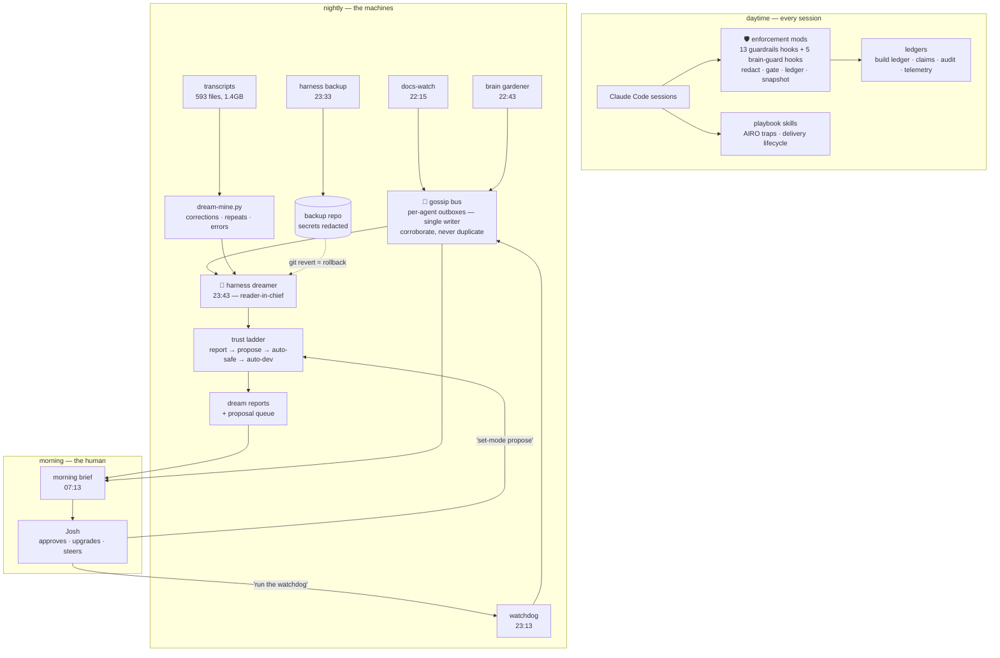

# Agentic Workato Kit

A self-teaching, self-learning, and self-healing development harness for
agentic Workato work in Claude Code. It wraps an AI-assisted Workato
developer (human or agent) in seven layers: enforcement mods that make the
standing rules mechanical, playbook skills that pass everything already
learned to every session, a Developer API wrapper for the operations the
platform tools do not expose, watcher agents that inspect the estate on a
schedule and corroborate each other over a shared bus, a curated knowledge
system that captures lessons and verifies them against live behavior, a
promotion pipeline that turns tracked dev work into governed production
releases, and a nightly dreamer that mines every session transcript to
improve the harness itself.

The design goal: no rule should depend on memory, no failure should depend on
luck, and no knowledge should live only in one session's context.

Audience: internal, Workato-All org. Examples and config may reference our
real workspaces, Jira project, and field IDs by design; they give a new
teammate a working starting point. Do not publish externally without a
sanitization pass (untrack config.sh, genericize the org identifiers).

## Quick start (5 minutes)

    git clone https://github.com/Workato-All/workato-agentic-kit.git
    cd workato-agentic-kit
    ./onboard.sh      # ~15 validating questions; tokens go to keychain, not files
    ./install.sh      # renders + installs everything
    ./verify.sh       # doctor: 32 checks, green means go

Then restart Claude Code and run `/guardrails`. Details below.

## The brain, as anatomy

Every agent is an organ. The roster:

| Organ | Agent | Function |
|---|---|---|
| memory consolidation | brain-gardener | curates, dedups, harvests knowledge; proposals as branches |
| proprioception | workato-watchdog | the body's status: connections, stalls, failures, canon checks |
| surveying | estate-architect | weekly estate review: cost, zombies, parity, lineage |
| motor planning | promotion-orchestrator | batches dev work into governed production releases |
| imagination | harness-dreamer | dreams (pragmatic + visionary); fixes at auto-dev |
| **the brain** | **cortex** | **attention, coherence, curiosity — reads everything, asks the questions nobody is asking, and directs the whole network's focus** |

The cortex is the difference between a bundle of scheduled jobs and a
nervous system: it reads the bus, the dreams, the claims, the canon, the
ledgers, and the briefs, and answers the question the rest of the machine
can't — what should we be attending to right now, and what is nobody
asking? Its outputs: the attention queue (the morning brief's top 3),
contradiction alerts (the highest-value signal in the system), and the
questions ledger that feeds the dreamer's mining targets and the gardener's
verification queue. It pulses hourly inside the hidden lane, bounded: read,
attend, max 3 bus lines, sleep.

## Architecture



The dream is a first-class organ: during the day the harness records itself
(mods ledger every mutation, telemetry logs every call, transcripts capture
every session); at night the dreamer reads all of that plus what the other
agents learned over the bus, and writes a report proposing what the harness
should become; in the morning one brief hands Josh the whole night with
corroboration counts as the trust signal. Nothing the dreamer proposes
applies without Josh, and anything applied is one git revert away.

## How the layers fit together

1. **Enforce (always on).** Two mods hook every tool call. They redact
   secrets, audit production writes, score push risk, gate Jira ticket
   quality, record every mutation, and snapshot every pushed recipe. Rules
   that used to live in instruction files are now code.
2. **Know (every session).** Two playbook skills ship with the kit: the
   AIRO MCP trap catalog and the governed-delivery lifecycle. A session
   that loads them starts with years of confirmed platform behavior
   instead of a blank slate; the enforced rules and the playbooks say the
   same thing.
3. **Watch (nightly).** Scheduled agents inspect the estate: broken
   connections with blast radius, stalled schedulers, failed-job autopsies,
   platform release notes. Each run leaves a heartbeat; the last job of the
   night checks the others and reports a skipped machine.
4. **Learn (nightly + weekly).** A curator agent reviews the knowledge base
   for drift, conflicts, and rot, mines session transcripts for unrecorded
   lessons, measures the harvest rate, and files proposals as git branches.
   Behavioral claims about the platform get re-verified as a side effect of
   real work.
5. **Operate (any time).** The `wt` CLI wraps the Workato Developer API for
   what AIRO MCP and the Dev CLI do not expose: manifests, packages, recipe
   lifecycle, job reruns, connection CRUD, property upserts.
6. **Promote (on demand).** A promotion orchestrator assembles batches from
   the build ledger, files the deployment story with your site's real field
   IDs, and stages production execution behind explicit approval.
7. **Dream (nightly).** A backup job snapshots the whole harness (secrets
   redacted) so agent-made changes are reversible, and a dreamer mines recent
   session transcripts for corrections, repeats, and recurring errors, then
   reports and proposes under a three-rung trust ladder. The agents talk over
   a race-free gossip bus; the dreamer reads the whole night's bus and
   synthesizes it last.

## The inventory in detail

### Mods (plugins, always loaded)

`workato-guardrails` registers 13 hooks on tool calls, prompts, and UI
renders. Each hook is a few lines; `claude plugin validate` lists exactly
what each touches before you load anything.

| # | Hook | Fires on | What it does |
|---|---|---|---|
| 1 | Secret redaction | every tool result | Strips API keys, tokens, Bearer headers, and `key: value` shaped secrets from results before the model reads them. Prose is untouched. Registered first so it sees every other hook's output last. |
| 2 | Prod-write audit | any write tool on the production AIRO MCP | Appends one line to an audit log and prints a transcript band. Never blocks. |
| 3 | Push risk scorer | every `recipe_builder_push` | Looks up the recipe's live health through the dependency tracker (running state, fail rate, last-run age, never-run) and annotates the result. On production pushes scoring medium or above, holds the call for an explicit proceed or cancel dialog. |
| 4 | Story-points gate | `createJiraIssue` | Denies ticket creation without a points value in the configured custom field, with the scale inline. Configurable exempt projects where the field is not on the screen. |
| 5 | URL linker | AIRO and tracker results | Appends canonical `app.workato.com` URLs for any recipe, table, or folder ID found in a result, so summaries always carry links. Skips results that already link. |
| 6 | Standards injection | prompts that create Jira work | Adds your story-standards document to the prompt as hidden context. Reads the live skill file at session start; embeds a fallback digest. |
| 7 | Datapill warning | `recipe_builder_pull` | Warns at the moment of exposure that DSL exports can show mapped datapills as literal sample values. |
| 8 | Writeback nudge | every Jira or Confluence write | Reminds to re-read the artifact and confirm rendering before calling it done. |
| 9 | Build ledger (AIRO) | every successful AIRO mutation | Appends one JSON line per mutation to a shared ledger: tool, server (dev or prod), session, recipe, folder, ticket. |
| 10 | Build ledger (CLI and browser) | Bash commands using the Workato CLI or Orca | Ledgers the paths that bypass AIRO. A successful CLI start also triggers a read-back that verifies the start actually took, refreshing the relevant platform claim. |
| 11 | Slash commands | user | `/guardrails` (hook status), `/builds` (ledger summary for today, week, or all), `/promotion-ready` (dev edits newer than their last promotion mark), `/promoted` (mark recipes shipped), `/diff` (recipe snapshot history). |
| 12 | Snapshot history and cockpit | every push; on demand | After each push, pulls the fresh DSL from the matching server and commits it to a local git repo, so "what changed in this recipe" is a diff. `/cockpit` opens a pane with session counters and the ledger tail. |
| 13 | Prod-write confirm gate | Bash commands that target production via ANY surface: `workato-prod`, `wt-prod`, `WORKATO_PROFILE`/`--profile` set to the prod profile, raw HTTP carrying the prod credential, Orca on prod URLs | Holds WRITES for an explicit confirm dialog, fail-closed on dismissal. Reads pass through. This is the door-closer that makes the prod CLI/wt wrappers safe to hand an agent. |

`brain-guard` registers 5 hooks for the knowledge system itself:

| Hook | Fires on | What it does |
|---|---|---|
| MCP telemetry | every MCP call | Logs tool, result byte size, and error class. This is what makes cost and failure reports possible. |
| Turn usage | every completed turn | Logs input, output, and cache token counts. |
| Skill telemetry | every skill load | Logs which skills sessions actually use. |
| Knowledge telemetry | every read or write of knowledge and memory files | Logs which knowledge is load-bearing and which is dead. |
| Write linter | every write or edit under the knowledge or memory trees | Nudges on relative dates without absolute anchors, memory files missing frontmatter, and knowledge writes with no index update. Annotates, never blocks. |

### Agents

Each agent is a markdown SOP in `~/.claude/agents/`. They are advisory: they
report and propose, they never mutate the estate or the knowledge base
without approval. The exception is proposal branches, which land only on
`gardener/*` branches of the knowledge repo.

Every agent is a node on the gossip bus: it reads the bus at start
(corroborates existing threads instead of duplicating them), posts its top
findings at end, and uses handoffs to route work to another agent. Protocol:
`knowledge/dreams/GOSSIP.md`.

**brain-gardener** (nightly 22:43, full review weekly). Reads its own
acceptance-rate log first, then inventories the knowledge tree against its
index, checks for conflicts, duplication, and temporal rot, rolls up
opportunistic claim verifications, mines session transcripts for unrecorded
lessons, and files a garden report with a top five priority list. Cadence
design: nightly runs review only what changed since the last report; the
weekly run does the full inventory.

**workato-watchdog** (nightly 23:13). Five checks: exception connections
with running-recipe blast radius (P1), stalled schedulers (running recipes
with no recent jobs, the silent post-restart failure class), failure
autopsies clustered by error class with proposed playbook entries, external
edit detection (recipes whose update time moved with no ledger entry, which
is how human UI edits and other agents show up), and postmortem drafts for
P1 incidents, filed only on approval. Opens with a machine-health line: if
last night's gardener or crawler never heartbeated, that is a P0.

**estate-architect** (Mondays 06:37, after the corpus indexer refreshes the
index). Six phases: cost heatmap coupling runtime tasks per folder with dev
token spend; zombie hygiene (recipes with no runs in 90 days, orphaned
tables and connections); config parity between environments (properties
diffed, secrets reported as set and hidden); lineage maps per folder as
mermaid diagrams with an optional field-level harvest on named folders;
security posture heuristics (personal-account connections, identity per
skill); and a deprecation radar matching platform release deltas against
recipes that use the affected features.

**promotion-orchestrator** (on demand; batches are inventory-driven, not
scheduled). Phase 1 selects the batch from the build ledger: dev mutations
newer than their last promotion marker, nothing else, ever. Phase 2
assembles the manifest with only those assets and captures the rollback
snapshot hash. Phase 3 files the deployment story (Story type, never a
deployment-request type) with the manifest URL, source and target
environment fields, points, and parent epic, showing the draft for approval
first. Phase 4 stages production execution: dependency order, VUA
verification after import, smoke tests per stage, each step on an explicit
go.

### Knowledge system

- **Knowledge tree** (`~/.claude/knowledge/`): a git repo. `INDEX.md` routes
  to `domains/` (cross-project knowledge) and `projects/` (per-project
  state). Everything is committed; the gardener's proposals arrive as
  branches you merge.
- **Claim ledger** (`claims/claims.jsonl`): durable knowledge as structured
  claims with evidence, confidence, and a last-verified date. Load-bearing
  behavioral assertions (does the platform still do X) live here so they can
  be checked rather than remembered. Supersede, never edit.
- **Opportunistic verification** (`claims/verifications.jsonl`): the mods
  stamp claims as real work exercises them (a push that succeeded while a
  recipe was running, a CLI start that was read back). The gardener rolls
  these into last-verified dates. A synthetic probe harness is deliberately
  parked; passive verification from real work covers most of its value.
- **Telemetry ledgers** (`garden-reports/usage-ledger.jsonl`): the usage
  feed the gardener and heatmap read. Build ledger lives at
  `~/.claude/knowledge/build-ledger.jsonl`.
- **Scripts** (`knowledge/scripts/`): cost heatmap, recipe corpus search,
  dedup shortlister, harvest-rate gauge, docs crawler, dream miner
  (`dream-mine.py`), trust-ladder control (`dream-config.py`), gossip-bus
  reader (`gossip-read.py`), and the harness backup. All stdlib python.
- **Dreams** (`knowledge/dreams/`): dated dream reports, the proposal queue
  (`proposals/`, status: proposed → approved → applied / rejected), the
  trust-ladder `config.json`, and the gossip bus (`bus/<agent>.jsonl`).
- **Garden reports** (`garden-reports/`): dated reports from every agent
  run, plus the proposal-outcomes log the gardener uses to grade itself.

### Playbook skills (installed to `~/.claude/skills/`)

**airo-mcp-playbook**. The trap catalog for the AIRO MCP: confirmed
silent-failure platform bugs (data table column updates that wipe rows,
dynamic table IDs that drop payloads, datapill exports that render as sample
values, session ID collisions, VUA reverts after push), Ruby DSL
restrictions inside recipes, Jira formatting traps, token-efficiency
practices, and delegation guidance. A skill-load of this playbook is what
keeps an AI-assisted build from rediscovering these failures the expensive
way. Five reference files under `references/` carry the full catalog.

**workato-development-playbook**. The delivery lifecycle for governed
Workato work: the actor model (human authority, agent coordination,
execution surfaces), the orient-and-contract phase, implementation and
whole-graph audit, acceptance and regression, evidence standards, and
promotion readiness. Reference files cover app and MCP surfaces,
reliability and observability, testing and release assurance, delivery and
release, and MCP server delivery. This is the process the watchdog and
promotion orchestrator assume.

Both skills are team knowledge: they load into every session and compound
as traps get confirmed. If a reference points at a document your team does
not have (one narrative file), delete the pointer or supply your own.

### Workato Toolbox (`wt`, installed to `~/.local/bin/`)

A python CLI over the Workato Developer API for the operations AIRO MCP and
the Dev CLI do not expose: manifest creation and asset listing, package
export and import with recipe restart, recipe start, stop, and force-run,
job rerun and cancel, lookup-table row writes, connections CRUD, and
project property upserts. Three discovery and testing capabilities on top:

- `wt discover` (+ `--refresh`): harvests the full Developer API reference
  (302 endpoints across 32 groups) from the docs markdown into a local
  index, reports new and removed endpoints since the last run, shows which
  groups have dedicated `wt` subcommands, and probes unimplemented groups
  for **scope gaps** (a login page or 401 missing-privilege means your API
  client needs that permission granted in Workspace admin). This is the
  self-discovery loop: Workato ships a new API group, the next `wt
  discover` sees it, and the gardener proposes the new subcommand.
  NOTE: `wt` sends browser-normal headers on every request because
  Workato's edge redirects python-urllib default headers (that User-Agent,
  `Accept-Encoding: identity`, no Accept) to the sign-in page on newer API
  routes, even with a valid token. If you script the API yourself with
  urllib, set a real User-Agent and Accept header or you will chase
  phantom scope gaps.
- `wt testcases run|status|cases`: the Test Automation API, programmatically.
  Run test cases by manifest, project, folder, recipe, or explicit IDs, then
  poll the run request. The shipped `regression-nightly.py` builds on this:
  it scans the workspace for recipes with test cases, runs them all, and
  writes a pass/fail report with job IDs for autopsy (first live run: 400
  recipes scanned, 3 with cases, 2 real regressions caught).
- `wt api METHOD <path>`: raw passthrough, so every discovered endpoint is
  callable even before a dedicated subcommand exists.

Authentication comes from `WORKATO_API_TOKEN` or the keychain entry the
Workato platform CLI stores; no token ships in this kit and none should.

**Production instances** (`wt-prod`, `workato-prod`): mirror the dev/prod
AIRO MCP split. Each wrapper reads the PRODUCTION token from the keychain
(`security add-generic-password -s workato-platform-cli -a <prod-profile> -w
<token> -U`) per invocation, so the prod credential never sits in a shell
profile, and prints a PROD banner. Every write through them is held for
confirmation by guardrails hook 13. `workato` (the Dev CLI) must be
overridden per invocation because it prefers `WORKATO_API_TOKEN` over the
keychain; the wrapper handles that.

### Schedules

All agent schedules are self-rearming: each run re-creates its task before
the platform's 7-day scheduler expiry lapses. See `schedules/README.md` for
the exact prompts.

| When | Job |
|---|---|
| 22:15 daily (launchd) | Docs crawler, unattended, no session needed |
| 22:31 daily | Docs crawler summary in-session |
| 22:43 daily | Brain gardener (incremental) |
| 23:13 daily | Workato watchdog, including the heartbeat check |
| 23:33 daily | Harness backup (git snapshot, secrets redacted, push if configured) |
| 23:43 daily | Harness dreamer (reader-in-chief of the bus; pragmatic + inventive report) |
| Mon 06:07 | Corpus indexer (recipes + task counters, dev and prod) |
| Mon 06:37 | Estate architect (full review) |
| 00:13 daily | Regression harness: run every recipe's test cases via the Test Automation API, report failures with job IDs |

## Install

1. Prerequisites: Claude Code 2.1.287 or later, git, python3, jq. Connect
   your MCP servers first (AIRO dev and prod, dependency tracker, Jira);
   the kit cannot do your authentication.
2. `./onboard.sh` — an interactive questionnaire: workspace IDs, Jira
   project/fields, CLI profile names, backup repo, and your API tokens
   (pasted once, stored straight into the macOS keychain, never written to
   a file). Answers are validated and written to config.sh (chmod 600).
   Prefer hand-editing? `cp config.example.sh config.sh` works too.
3. `./install.sh` — renders templates and installs: mods, agents, skills,
   scripts, prod wrappers, dreams scaffold, gossip outboxes.
4. `./verify.sh` — the doctor. 32 checks across prereqs, config, binaries,
   live dev/prod identity, mods, knowledge tree, agents, skills, MCP
   health, crons, and backup. Exits non-zero on hard failures.
5. Restart Claude Code, then run `/guardrails` to confirm the hooks loaded
   (13 hooks in workato-guardrails).
5. Prod CLI access (only if you gate production through this kit): store the
   prod API token in the keychain for the `PROFILE_PROD` account, then
   `workato-prod` / `wt-prod` target production and every write confirms
   first. Test with a read: `wt-prod api GET /api/users/me`.
6. Harness backup: set `BACKUP_REPO_LOCAL` + `BACKUP_REPO_URL` in config.sh
   (empty URL = local commits only), then run `harness-backup` once and check
   the push.
7. Set up schedules from `schedules/README.md`. Keep the nightly order:
   docs-watch first (first bus poster), dreamer last (reader-in-chief).
8. The dreamer starts at trust-ladder mode `report`. Read the dream reports
   for a few nights, then upgrade with
   `python3 ~/.claude/knowledge/scripts/dream-config.py set-mode propose`
   (and later `auto-safe`). `auto-dev` is the destination rung: agents act on the dev estate overnight and Josh wakes to fixed, verified, revertable work plus a triage queue. `never_auto` is constitutional in every mode.

## The self-improvement loop (dreamer + gossip bus)

This is the layer that makes the kit compound instead of decay: the harness
watches itself, learns from every session, and proposes its own improvements
under human control. Two nightly jobs plus a communication layer.

### Nightly timeline

| Time (local) | Job | Role on the bus |
|---|---|---|
| 22:15 (launchd) + 22:31 | docs-watch | first poster: platform doc deltas |
| 22:43 | brain gardener | curates knowledge, posts stale-claim findings |
| 23:13 | workato watchdog | posts connection health, stalls, autopsies |
| 23:33 | harness backup | snapshots the whole harness (secrets redacted) |
| 23:43 | harness dreamer | reader-in-chief: merges the night, writes the dream |
| 07:13 | morning brief | one digest: machine + bus + dream + Jira + repos |

Order is load-bearing: each agent can read what the previous one posted, and
the dreamer runs last so the dream synthesizes the whole night.

### Harness backup (23:33)

`harness-backup.sh` copies skills, agents, the knowledge tree, mods,
scheduled tasks, and settings into a git repo, with secrets redacted
(token/key/secret values become `[REDACTED-BACKUP]`). This is what makes it
safe to let agents modify the system they run in: any applied change is
reversible with `git revert` on the backup repo.

- Configure via `BACKUP_REPO_LOCAL` (local clone) and `BACKUP_REPO_URL`
  (origin) in config.sh. Empty URL = local commits only.
- Never copied: session transcripts (they contain verbatim secrets),
  keychain entries, credential files, audit logs.
- Restore: clone the repo, copy trees back to `~/.claude` / `~/mods`,
  re-enter keychain tokens, reinstall plugins, reload LaunchAgents.

### The dreamer (23:43) — agent type `harness-dreamer`

The fifth agent SOP, and the only one that reads the harness instead of the
estate. The nightly cron spawns it; it returns the report path + verdict.

Mines the last N days of Claude Code session transcripts
(`~/.claude/projects/**/*.jsonl`) via `scripts/dream-mine.py` (stdlib,
read-only, bounded): session counts, correction candidates (user messages
matching correction heuristics, with noise guards for system-injected
lines), recurring error strings, tool frequencies, and repeated 4-gram tool
sequences.

The daily dream report (`knowledge/dreams/<date>.md`) carries two mandates:

- **PRAGMATIC** — evidence-cited findings for four questions: what is Josh
  working on, what is he repeating, what are the frequent mistakes or
  misses, what would have made yesterday faster. Every finding cites a
  transcript ref, ledger line, or count.
- **THE VISION** — the richest man among us is a dreamer who sits back and
  dreams, writes, or sings about what is to come. Every night leaves a seed
  of pure speculation in the report; when a vision is substantial the
  dreamer writes it whole to `knowledge/dreams/visions/` — essay, letter
  from the future, manifesto, or song. No evidence requirement; the quality
  bar is "would this make Josh think differently". Visions mature down the
  pipeline: vision → invention → proposal → skill.

Below the mandates: a proposal queue table. Proposals (when the ladder
allows) land in `knowledge/dreams/proposals/` with frontmatter
`status: proposed` and are reviewed by you, never applied unseen.

### Trust ladder

Enforced by `knowledge/dreams/config.json`. The dreamer reads it FIRST each
run and obeys it; if the file is missing it behaves as `report`.

| mode | what the dreamer may do |
|---|---|
| report | write the dream report. Zero writes outside `knowledge/dreams/`. |
| propose | + file proposals. Nothing is applied; you review. |
| auto-safe | + auto-apply ONLY: knowledge-file deltas, INDEX lines, memory pointers, claim verifications. |
| auto-dev | + bounded dev fixes: AIRO dev edits, dev stop/start/test, test-case runs, ledger + Jira status comments. Mandatory snapshot→edit→test→verify→ledger; any failure reverts and downgrades to a proposal. Cap 3 fixes/night. |

Upgrade and downgrade are one command:

    python3 ~/.claude/knowledge/scripts/dream-config.py set-mode propose
    python3 ~/.claude/knowledge/scripts/dream-config.py set-mode auto-safe
    python3 ~/.claude/knowledge/scripts/dream-config.py show

**`never_auto` is constitutional in every mode**: skills, hooks, mods,
agents, settings, crons, MCP config, and commands are proposal-only forever,
regardless of how safe an individual change looks. The only way to change
that list is editing `config.json` yourself.

Suggested cadence: run `report` for a week, read the reports, upgrade to
`propose`, review proposals for another week, then decide on `auto-safe`.

### Gossip bus (agent-to-agent communication)

Six agents (docs-watch, brain-gardener, workato-watchdog, harness-dreamer,
estate-architect, promotion-orchestrator) communicate over per-agent outbox
files — the maildir pattern:

```
knowledge/dreams/bus/
  docs-watch.jsonl            <- only docs-watch appends here
  brain-gardener.jsonl        <- only the gardener appends here
  workato-watchdog.jsonl
  harness-dreamer.jsonl
  estate-architect.jsonl
  promotion-orchestrator.jsonl
```

Every file has exactly one writer, so there are no locks, no races, and no
overwrites at any level of parallelism. The merged view is computed on read,
not on write: `scripts/gossip-read.py` merges all outboxes, sorts by time,
tallies corroborations per thread, and applies TTL expiry.

Event schema (one JSON object per line, append-only):

```json
{"ts":"2026-10-07T23:15:00Z","agent":"watchdog","kind":"finding",
 "subject":"broken-snowflake-conn","line":"one sentence with specifics",
 "refs":["https://app.workato.com/connections"],
 "thread_id":"broken-snowflake-conn","corroborations":0,"ttl_days":14}
```

- `kind`: **finding** (new observation) | **verify** (corroboration of an
  existing thread) | **handoff** (route work to another agent) |
  **proposal-ref** (pointer to a dream proposal)
- `subject`/`thread_id`: same kebab-slug for every event about the same
  underlying thing — this is how corroboration is counted

**Protocol, every agent:** read the bus at start (`gossip-read.py --since
24h`; if your finding already has a thread, append `verify` to YOUR outbox
on that thread instead of duplicating it), post your top findings at end
(max 3, terse, with refs — nothing on the bus without a reference), and use
handoffs to route work: watchdog finds it, the dreamer proposes a guard, the
gardener verifies the claim, Josh approves.

**Corroboration is the confidence unit:** 1 witness = observation, 2
witnesses = pattern, 3+ = act on it. Independent agents corroborating is the
strongest evidence class the harness has, and the dreamer leads its report
with corroborated threads.

**Reading it:**

    python3 ~/.claude/knowledge/scripts/gossip-read.py --since 24h        # timeline + tallies
    python3 ~/.claude/knowledge/scripts/gossip-read.py --thread <slug>    # one thread
    python3 ~/.claude/knowledge/scripts/gossip-read.py --since 7d --json  # machine-readable

**Adding a new agent to the network:** create
`knowledge/dreams/bus/<name>.jsonl`, add a "Gossip bus" section to its brief
(copy it from any existing agent SOP, changing the outbox path and the
"what you post" line), and pick a slot in the nightly order. Nothing else to
wire.

### Morning brief (07:13)

One digest under 40 lines (`knowledge/morning-brief/<date>.md`): machine
heartbeat first (a skipped nightly job is the headline), bus threads with
patterns before solo findings, dream verdict, watchdog P1s, your Jira
movements, and repo commits from the last 24h. Empty sections say
"nothing" — no padding. If you read one thing in the morning, read this.

### Troubleshooting

- **The bus is quiet** — the nightly agents only fire while a Claude Code
  session is open and idle at their fire time. No session, no run. Check
  `knowledge/garden-reports/heartbeat.jsonl` for who last ran.
- **A job skipped last night** — the morning brief leads with it. The
  self-rearm instructions re-create crons before the 7-day expiry, but only
  from within a session.
- **A dream report contradicts the platform** — dream findings are mined
  heuristics, not verified claims; the claim ledger is the source of truth.
  File the correction as a new line on the thread, never an edit.

## Trust model

The mods run with your permissions and are not sandboxed. Every hook
declares the events it handles, and `claude plugin validate <dir>` prints
every event and API call before you install. The prod-write confirm gate
(hook 13) fails closed: a dismissed dialog blocks the command. The agents
are read-only against Workato: production import steps run only on explicit
approval, one stage at a time, and knowledge mutations land as proposal
branches. The dreamer's trust ladder is enforced by config, and its
`never_auto` list (skills, hooks, mods, agents, settings, crons, MCP) cannot
be auto-applied in any mode. Rollback for the whole kit is three commands:
`claude plugin uninstall <mod>`, deleting `~/.claude/agents` entries, and
`git revert` on the backup repo for anything an agent applied.

## Layout

```
config.example.sh     per-person settings (workspaces, Jira fields)
install.sh            renders templates + installs everything
mods/                 the two plugins (hook modules + tests)
agents/               the five agent SOPs (four watchers + the dreamer)
skills/               airo-mcp-playbook, workato-development-playbook,
                      jira-story-standards (adapt to your team)
bin/wt                Workato Toolbox: Developer API wrapper (manifests,
                      packages, lifecycle, jobs, properties, lookups)
bin/wt-prod           PRODUCTION wrappers (keychain token, confirm gate);
bin/workato-prod      mirror the dev/prod AIRO MCP split
knowledge/            INDEX template + scripts + claim-ledger schema
knowledge/dreams/     dreamer trust-ladder config + gossip-bus scaffold
schedules/            cron prompt templates + launchd plist
```

## Tested with

Claude Code 2.1.289 on macOS. The mods use standard mod events (`tool.call`,
`prompt.submit`, `ui.render`, `turn.complete`, `command.run`); drawing
surfaces fall back to text in VS Code, headless, and SDK contexts. Windows
is untested.
