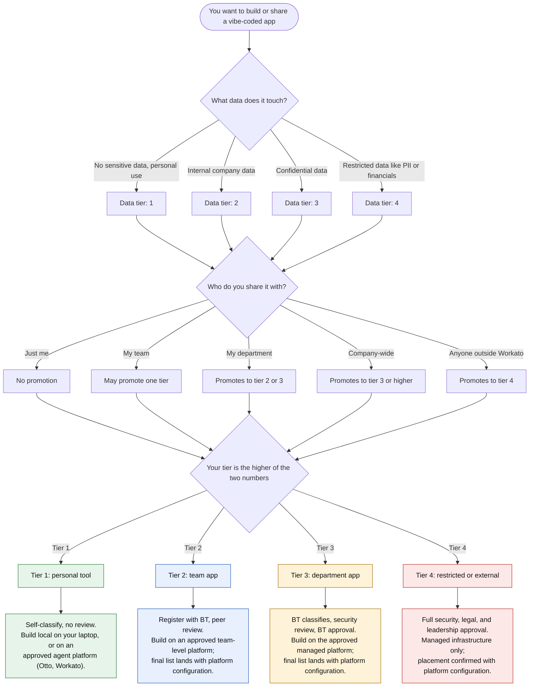

# Platform Decision Tree

Two questions decide everything: what data does your app touch, and who do you share it with. Answer both and the tree lands you on a tier with the requirements and the platform to match. You should never need to read the policy for a classification.

## How to use it

Start at the top. The first question sets your starting tier from the data. The second question asks about sharing, because sharing can promote you. Your final tier is the higher of the two numbers. The colored boxes at the bottom are what that tier asks of you.

## Worked examples

A few scenarios, walked end to end.

**You built a personal expense tracker.** It touches no sensitive data and only you use it. Tier 1, no review, build it locally and move on with your day.

**Your team dashboard with internal metrics.** Internal data, shared with your team. Tier 2. Register with BT, grab a peer review, build on an approved team-level platform.

**That same dashboard, now pulling Salesforce numbers.** Confidential data. The app just became Tier 3 regardless of who it is shared with. BT classifies it, Security reviews it, BT approves the deployment.

**A customer-facing tool of any kind.** Anything outside Workato sees Tier 4. That means security, legal, and leadership before it ships. Do not start this one without talking to us first.

## Platform names, and why some boxes are vague

The governance policy lists the approved platforms: your local machine, Otto, the Workato platform (Genies, MCP servers, Skills), Lovable, and Workato AWS (Amplify, EC2, S3, SQS, Lambda). Everything else, including personal cloud accounts, is off-limits.

The tree deliberately says "approved platform" rather than naming one per tier in most boxes, because platform configuration is being finalized right now. Which platform serves which tier gets locked when that lands, and the onboarding guides follow. If you need a platform today, the Tier 1 answer (local, Otto, Workato) is safe, and everything else starts with a conversation with BT.

If the classification process or the platform list changes, this tree changes in the same session. Check the date on the [governance policy](https://workato.atlassian.net/wiki/spaces/extbt/pages/2553184311/Vibe-Coded+App+Governance+Policy) if you want to confirm you are looking at the current rules.
